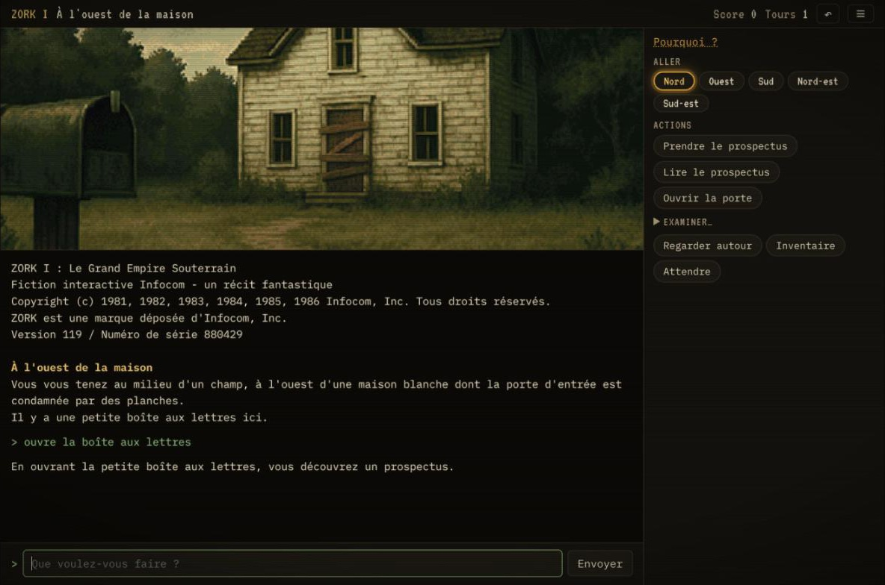

# Zork Next

**A fan tribute to Zork I: The Great Underground Empire (Infocom, 1980), playable in French in
the browser, with the sights and sounds the original never had.**



You are standing in an open field west of a white house… and this time you can see it, and
hear the wind in the trees.

**[Play it online](https://mathieuancelin.github.io/nzork/)**

Zork Next does not remake Zork. It runs the **original 1980s story file**, untouched, and wraps
it in what a modern browser can offer: a complete French translation, pixel-art illustrations
in the spirit of the VGA adventure games, an eerie soundtrack composed live as you play, help
modes for newcomers, and save slots. Every puzzle, every grue and every one of the 350 points is
exactly where Infocom left them.

> **Unofficial fan project.** Zork Next is a non-commercial tribute, made out of love for the
> game. It is not affiliated with, endorsed by or sponsored by Infocom, Activision or
> Microsoft. ZORK is a registered trademark of its owner. See [Credits and licenses](#credits-and-licenses).

## What it adds

- **The real game.** The original `zork1.z3` (Release 119, serial 880429) runs in a Z-machine
  written in TypeScript. It reproduces the reference interpreter `dfrotz` word for word, fights
  and randomness included: the tests replay the full 350-point walkthrough against it.
- **Fully in French.** Every text of the game is translated, with proper gender and number
  agreement (« la boîte est fermée », « l'épée »), and a French parser understands commands
  such as `prends la lanterne`, `ouvre-la` or `mets l'épée dans la vitrine puis va au nord`.
  The original English is one setting away.
- **Illustrations.** 93 pixel-art scenes cover the 110 rooms, drawn on a 480×270 grid with a
  shared 64-color palette, including state variants (the troll in his room, the drained
  reservoir, the rainbow made solid…). Dark rooms stay dark, except for two eyes that light up
  if you linger.
- **A soundtrack that gets under your skin.** Go down the trap door and the wind gives way to a
  deep drone and water dripping somewhere in the dark. Let your lantern die and a heartbeat
  rises while something breathes close by. Walk into the troll's room and a war drum starts. The
  music follows the game: one ambience per kind of place (forest, house, caves, mine, river and
  dam, temples, Hades, the maze), darkness and danger on top of it, and short cues for points,
  death and victory. It is generated live by the browser, never loops, and stays low under the
  text. Headphones recommended.
- **Three ways to play.**

  | Mode | How you play |
  |---|---|
  | Classic | Type your commands, as in 1980. |
  | Noob | Click on actions computed from the game state at every turn (moves, objects, special actions). Typing is still available. |
  | Hyper noob | Same choices, and the right one is circled in gold, with a "Why?" that explains it. A goal-based guide adapts to the thief and to fights. |

  You can switch modes at any time, even in the middle of a game.
- **Saves and undo.** 10 save slots plus an autosave, export and import of a save file, and
  **undo** (Ctrl+Z), on by default.
- **Retro touches, modern comfort.** Optional CRT scanlines and typewriter effect, adjustable
  font size, a layout that works on phones, and an installable app (PWA) that plays offline.

## Play

Requirements: Node.js 24 or later.

```bash
git clone --recurse-submodules https://github.com/mathieuancelin/nzork.git
```

```bash
npm install
```

```bash
npm run dev
```

Then open the address shown (http://localhost:5173). You can also play in the terminal:

```bash
npm run play
```

(`npm run play -- --en` plays the original English version.)

The submodule ([vendor/zork1](#the-original-sources)) is only needed by the development tools:
playing, testing and building work without it.

### Useful commands

| Command | Meaning |
|---|---|
| `n`, `s`, `e`, `o`, `ne`, `no`, `se`, `so`, `monter` (`h`), `descendre` (`b`) | move (`o` is west, *ouest*) |
| `i` / `r` / `x objet` / `z` | inventory / look / examine / wait |
| `prends tout`, `prends tout sauf l'épée` | take all, take all but the sword |
| `sauvegarder`, `charger`, `annuler` (Ctrl+Z), `recommencer`, `aide` | save, restore, undo, restart, help: handled by the interface |

## Deploy on GitHub Pages

The workflow [.github/workflows/pages.yml](.github/workflows/pages.yml) runs the type check, the
tests (including the comparison with `dfrotz`, installed in CI) and the build on every push and
pull request. A push to `main` then publishes the site.

To do once on GitHub: **Settings > Pages > Build and deployment > Source: "GitHub Actions"**.
The game is then online at `https://<user>.github.io/<repository>/` (paths are relative, so no
repository name needs to be configured).

## Tests

```bash
npm test
```

They check, among other things, that the full 350-point game is identical to `dfrotz` word for
word, that it can also be played with French commands without a single English word on screen,
and that the Hyper noob guide finishes the game on its own. The comparison tests need `dfrotz`
(from the `frotz` package) and are skipped when it is missing.

The guide can also be watched playing alone:

```bash
npm run bot -- 1234 --fr --verbose
```

## Illustrations

The images in [public/scenes/](public/scenes) were generated with AI image models from the
prompts of this repository, then reduced to the pixel grid and palette by a post-processing
step. The whole pipeline is included, to regenerate a scene or the full set with your own API
key. The art direction is described in [tools/images/style-bible.md](tools/images/style-bible.md)
and the prompts are in [tools/images/prompts.json](tools/images/prompts.json).

1. Put your key in a `.env` file at the root (it is ignored by git):

   ```
   OPENAI_API_KEY=sk-...
   # or
   OPENROUTER_API_KEY=sk-or-...
   ```

2. Generate the **5 keystone scenes** (4 candidates each). Without `--yes`, the command only
   prints the plan and the estimated cost:

   ```bash
   npm run images:generate -- --provider openai --keystones --count 4
   ```

   ```bash
   npm run images:generate -- --provider openai --keystones --count 4 --yes
   ```

3. Pick the best ones in the review page (http://localhost:5180). Each candidate is shown raw
   and after post-processing (480×270, 64-color palette).

   ```bash
   npm run images:review
   ```

4. Compute the shared palette from the approved keystones, then publish them again with it:

   ```bash
   npm run images:palette
   ```

   ```bash
   npm run images:postprocess
   ```

5. Generate every other scene: the approved keystones are sent as **style references** with each
   request.

   ```bash
   npm run images:generate -- --provider openai --missing --count 3 --yes
   ```

   Then go back to step 3 to choose. The game shows an image as soon as it is published in
   `public/scenes/`; until then, a colored placeholder stands in for the scene.

Providers: `openai` (model `gpt-image-1` by default, `ZORK_OPENAI_MODEL` to change it) and
`openrouter` (model `google/gemini-2.5-flash-image` by default, `ZORK_OPENROUTER_MODEL`). Expect
a few cents per image, around 10 to 30 USD for the full set with several candidates per scene
(check current prices with the provider).

## Soundtrack

There is not a single audio file in the game. Everything you hear is synthesized on the fly with
the Web Audio API: detuned oscillators drifting through slow filters, filtered noise for the
wind, the water and the rumbles, a generated cave reverb, and short sounds played at random
moments (drops, creaking wood, far bells, whispers, rolling pebbles, metal, birds, breathing).
Each ambience crossfades into the next as you move, and the mood reacts to what happens: no
light, a villain in the room, a treasure in the case, a death. The whole thing weighs a few
kilobytes.

The ambiences are data in [src/ui/sound/presets.ts](src/ui/sound/presets.ts); each scene of
[src/data/scenes.json](src/data/scenes.json) names its ambience. To tune them by ear, run
`npm run dev` and open `/sound-lab.html`: it plays each ambience with sliders for its settings,
measures the levels, balances them, and copies the result back as JSON.

## The original sources

[vendor/zork1](vendor/zork1) is a git submodule pointing to
[historicalsource/zork1](https://github.com/historicalsource/zork1), the ZIL source code of
Zork I released by Microsoft under the MIT license. The game does not need it at runtime (it
runs the compiled story file kept in [src/engine/story/](src/engine/story)), but the tools read
it to rebuild the symbol table, extract the text catalog, print the map and describe the scenes
for the image prompts.

If you cloned without `--recurse-submodules`:

```bash
git submodule update --init
```

## Architecture

| Folder | Role |
|---|---|
| `src/engine/zmachine/` | Z-machine v3, Frotz random number generator, disassembler |
| `src/engine/story/` | `zork1.z3` and its symbol table (ZIL names of objects, attributes, globals, routines) |
| `src/engine/i18n/` | text rendering: templates, French grammar, catalog in `fr/catalog.json` |
| `src/engine/input/` | French command parser |
| `src/engine/assist/` | clickable choices and the Hyper noob guide |
| `src/ui/` | the React application |
| `tools/` | symbols, catalog extraction and merge, `dfrotz` oracle, images, bot |
| `vendor/zork1/` | the original ZIL sources (git submodule) |

The design notes are in [specs.md](specs.md). The translation follows
[src/engine/i18n/fr/GUIDE-TRADUCTION.md](src/engine/i18n/fr/GUIDE-TRADUCTION.md) (in French).

## Credits and licenses

- **Zork I** was written by Marc Blank, Dave Lebling, Bruce Daniels and Tim Anderson, and
  published by Infocom in 1980. Its source code and compiled story file were released by
  Microsoft under the MIT license in 2025: see [src/engine/story/LICENSE](src/engine/story/LICENSE)
  and the [vendor/zork1](vendor/zork1) submodule.
- **ZORK** is a registered trademark of its owner. This project uses the name only to refer to
  the game it pays tribute to.
- **Zork Next** (the Z-machine, the French translation, the interface, the tools and the
  illustrations) is released under the [MIT license](LICENSE).
- Fonts: [VT323](https://fonts.google.com/specimen/VT323) and
  [IBM Plex Mono](https://fonts.google.com/specimen/IBM+Plex+Mono), served by Google Fonts.
- Thanks to the [Frotz](https://davidgriffith.gitlab.io/frotz/) team, whose interpreter is the
  reference the engine is tested against.
